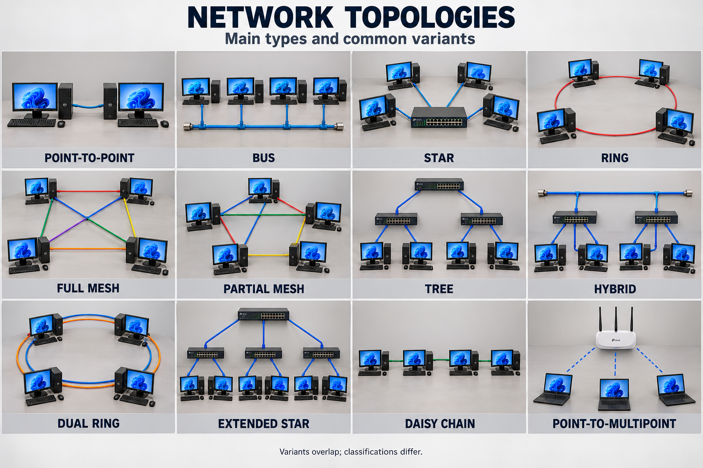

# Physical topologies
---
# عکسی از کله توپولوژی هایه فیزیکی

	

### ۱. Point-to-Point — نقطه‌به‌نقطه

**چیست؟**  
یک اتصال مستقیم بین دو دستگاه؛ یعنی لینک فقط دو سر دارد.

**مثال:** اتصال دو روتر با فیبر، یا اتصال مستقیم دو کامپیوتر با کابل شبکه.

**کجا استفاده می‌شود؟**  
برای اتصال دو ساختمان، دو روتر، یا ارتباط بی‌سیم مستقیم بین دو نقطه.

**هزینه:**  
برای فاصلهٔ کوتاه معمولاً کم؛ برای فاصلهٔ زیاد، فیبرکشی یا تجهیزات رادیویی می‌تونه گران باشه.

**مزایا:**

- ساده و معمولاً راحت برای عیب‌یابی.
- ظرفیت لینک بین همین دو دستگاه استفاده می‌شود.
- به دستگاه واسط نیاز ندارد، اگر دو طرف بتوانند مستقیم ارتباط برقرار کنند.

**معایب:**

- به‌تنهایی فقط دو دستگاه را وصل می‌کند.
- اگر همین لینک قطع شود، ارتباط دو طرف از بین می‌رود؛ مگر مسیر دیگری داشته باشند.

**نکته:** «مستقیم» بودن اتصال به معنی رمزگذاری یا امنیت خودکار نیست.

---

### ۲. Bus — خطی یا گذرگاهی

**چیست؟**  
همهٔ دستگاه‌ها به **یک مسیر ارتباطی مشترک** وصل‌اند. در اترنت خطی قدیمی، این مسیر یک کابل کواکسیال بود.

**مثال:** چند کامپیوتر که با اتصال‌های انشعابی به یک کابل اصلی وصل شده‌اند.

**کجا استفاده می‌شود؟**  
در شبکه‌های قدیمی اترنت و برخی شبکه‌های صنعتی مبتنی بر گذرگاه. برای شبکهٔ معمول کامپیوترهای امروزی انتخاب رایجی نیست.

**هزینه:**  
در پیاده‌سازی‌های ساده کابل کمی لازم دارد؛ ولی خرابی و عیب‌یابی می‌تواند هزینهٔ نگهداری را زیاد کند.

**مزایا:**

- ساختار ساده.
- کابل کمتر نسبت به کابل‌کشی جداگانه برای هر دستگاه.
- در بعضی کاربردهای صنعتی مناسب و کاربردی است.

**معایب:**

- خرابی کابل اصلی می‌تواند ارتباط بخش بزرگی از شبکه را مختل کند.
- ظرفیت مسیر مشترک بین دستگاه‌ها تقسیم می‌شود.
- پیدا کردن محل خرابی می‌تواند دشوار باشد.
- در اترنت خطی قدیمی، ارسال هم‌زمان دستگاه‌ها می‌تواند باعث برخورد داده‌ها شود.

**نکته:** کابل اترنت کواکسیال قدیمی در **هر دو انتها Terminator** می‌خواهد تا بازتاب سیگنال کنترل شود. این الزام را نمی‌توان به همهٔ فناوری‌های Bus تعمیم داد.

---

### ۳. Star — ستاره‌ای

**چیست؟**  
هر دستگاه با یک لینک جدا به **دستگاه مرکزی** وصل می‌شود؛ در شبکه‌های امروزی معمولاً یک سوئیچ.

**مثال:** کامپیوترهای یک دفتر که هرکدام با کابل به سوئیچ متصل‌اند.

**کجا استفاده می‌شود؟**  
خانه‌ها، دفاتر، آزمایشگاه‌ها، مدارس و بسیاری از شبکه‌های محلی.

**هزینه:**  
معمولاً متوسط؛ یک سوئیچ و کابل جدا برای هر دستگاه لازم دارد.

**مزایا:**

- قطع کابل یک دستگاه معمولاً فقط همان دستگاه را از شبکه خارج می‌کند.
- اضافه کردن دستگاه و عیب‌یابی آسان است.
- هر اتصال به سوئیچ ظرفیت لینک خودش را دارد.

**معایب:**

- خرابی سوئیچ مرکزی ارتباط دستگاه‌های وابسته به آن را مختل می‌کند.
- کابل بیشتری نسبت به Bus لازم دارد.
- تعداد پورت‌ها و ظرفیت سوئیچ محدودیت ایجاد می‌کند.

**نکته:** **Hub و Switch یکسان نیستند.** سوئیچ معمولاً فریم را به پورت مناسب هدایت می‌کند؛ هاب داده را به همهٔ پورت‌های دیگر تکرار می‌کند.

---

### ۴. Ring — حلقوی

**چیست؟**  
دستگاه‌ها یا تجهیزات شبکه در یک حلقهٔ بسته قرار می‌گیرند؛ هر گره در حلقهٔ ساده دو همسایه دارد.

**مثال:** چند سوئیچ صنعتی که به‌ترتیب به هم متصل‌اند و آخرین سوئیچ دوباره به اولین سوئیچ وصل شده است.

**کجا استفاده می‌شود؟**  
برخی شبکه‌های صنعتی، شبکه‌های انتقال و فناوری‌های قدیمی مثل Token Ring.

**هزینه:**  
معمولاً متوسط؛ تجهیزات و سازوکار محافظت در برابر خرابی می‌توانند هزینه را بیشتر کنند.

**مزایا:**

- می‌تواند کابل‌کشی مناسبی برای دستگاه‌های پراکنده در یک مسیر حلقوی داشته باشد.
- با پروتکل مناسب، امکان استفاده از مسیر جایگزین وجود دارد.
- بعضی فناوری‌های حلقوی دسترسی به رسانه را به‌صورت منظم مدیریت می‌کنند.

**معایب:**

- در حلقهٔ بدون محافظت، قطع یک لینک می‌تواند ارتباط را مختل کند.
- توسعه و عیب‌یابی ممکن است پیچیده‌تر باشد.
- داده ممکن است از چند گره میانی عبور کند.

**نکته:** وصل کردن سوئیچ‌های اترنت در حلقه بدون تنظیم مناسب می‌تواند **Loop** ایجاد کند؛ باید سازوکاری مثل STP یا پروتکل حلقهٔ مناسب وجود داشته باشد.

---

### ۵. Full Mesh — مش کامل

**چیست؟**  
هر دستگاه مستقیماً به **تمام دستگاه‌های دیگر** متصل است.

**مثال:** چهار روتر که بین هر دو روتر یک لینک مستقیم وجود دارد؛ مجموعاً شش لینک.

**کجا استفاده می‌شود؟**  
بین تعداد محدودی از روترها یا نقاط مهمی که ارتباط مستقیم و مسیرهای متعدد لازم دارند.

**هزینه:**  
زیاد؛ تعداد لینک‌ها و پورت‌های موردنیاز به‌سرعت افزایش پیدا می‌کند.

**مزایا:**

- مسیرهای متعدد برای ارتباط.
- خرابی یک لینک معمولاً با مسیرهای دیگر قابل جبران است.
- بین هر دو گره لینک مستقیم وجود دارد.

**معایب:**

- کابل، پورت و تجهیزات زیادی نیاز دارد.
- تنظیم، مدیریت و نگهداری پیچیده است.
- برای تعداد زیاد دستگاه‌ها معمولاً به‌صرفه نیست.

**نکته:** تعداد لینک‌های مش کامل با \(n\) دستگاه:

\[ L=\frac{n(n-1)}{2} \]

برای **۵ دستگاه، ۱۰ لینک** و برای **۱۰ دستگاه، ۴۵ لینک** لازم است. استفاده از مسیرهای جایگزین هم به تنظیم درست شبکه وابسته است.

---

### ۶. Partial Mesh — مش جزئی

**چیست؟**  
بعضی دستگاه‌ها چند اتصال دارند، اما همه به همه وصل نیستند.

**مثال:** روترهای مهم چند مسیر ارتباطی دارند، ولی یک شعبهٔ کوچک فقط به دو روتر متصل است.

**کجا استفاده می‌شود؟**  
شبکه‌های سازمانی و ارتباط بین شعب یا سایت‌ها.

**هزینه:**  
معمولاً کمتر از Full Mesh؛ میزان هزینه به تعداد لینک‌های اضافی بستگی دارد.

**مزایا:**

- تعادل مناسب بین هزینه و تحمل خرابی.
- امکان ایجاد مسیر جایگزین برای نقاط مهم.
- قابلیت توسعهٔ بهتر نسبت به مش کامل.

**معایب:**

- همهٔ نقاط میزان یکسانی از پایداری ندارند.
- طراحی مسیرها و مسیریابی پیچیده‌تر است.
- بعضی لینک‌ها یا دستگاه‌ها ممکن است همچنان نقطهٔ ضعف باشند.

**نکته:** لینک اضافی را جایی قرار می‌دهیم که خرابی آن بیشترین اثر را دارد؛ صرفاً زیاد کردن اتصال‌ها کافی نیست.

---

### ۷. Tree — درختی

**چیست؟**  
اتصال‌ها **سلسله‌مراتبی و شاخه‌ای** هستند؛ یک سطح بالاتر به چند شاخه و هر شاخه به دستگاه‌های پایین‌تر متصل می‌شود.

**مثال:** سوئیچ اصلی ساختمان به سوئیچ هر طبقه وصل است و کامپیوترها به سوئیچ طبقهٔ خودشان وصل‌اند.

**کجا استفاده می‌شود؟**  
ساختمان‌های چندطبقه، دانشگاه‌ها و شبکه‌های سازمانی.

**هزینه:**  
معمولاً متوسط تا زیاد؛ به تعداد شاخه‌ها و ظرفیت تجهیزات بالادستی بستگی دارد.

**مزایا:**

- ساختار منظم و توسعه‌پذیر.
- تقسیم شبکه به بخش‌ها آسان‌تر است.
- خرابی یک شاخه معمولاً مستقیماً شاخه‌های دیگر را قطع نمی‌کند.

**معایب:**

- خرابی تجهیزات بالادستی می‌تواند چند شاخه را هم‌زمان قطع کند.
- لینک‌های بالادستی ممکن است گلوگاه شوند.
- درخت ساده مسیر جایگزین ندارد.

**نکته:** اضافه کردن لینک‌های پشتیبان می‌تواند ساختار را از یک درخت خالص به ترکیبی از درخت و مش تبدیل کند.

---

### ۸. Hybrid — ترکیبی

**چیست؟**  
ترکیب دو یا چند الگوی توپولوژی در یک شبکه.

**مثال:** داخل هر دفتر شبکه ستاره‌ای است، ولی روترهای دفاتر به شکل مش جزئی به هم متصل‌اند.

**کجا استفاده می‌شود؟**  
شبکه‌های بزرگ و سازمان‌هایی که بخش‌های مختلفشان نیازهای متفاوت دارند.

**هزینه:**  
متغیر؛ می‌تواند ساده و کم‌هزینه یا بسیار پیچیده و گران باشد.

**مزایا:**

- انعطاف زیاد.
- امکان انتخاب ساختار مناسب برای هر بخش.
- امکان بهینه کردن هزینه و پایداری.

**معایب:**

- طراحی و عیب‌یابی پیچیده‌تر.
- ممکن است به تجهیزات و مهارت‌های متنوع نیاز داشته باشد.
- ضعف یک بخش می‌تواند روی بخش‌های وابسته اثر بگذارد.

**نکته:** Hybrid یک شکل ثابت ندارد؛ تصویر فقط **یکی از مثال‌های ترکیبی** را نشان می‌دهد.

---

### ۹. Dual Ring — حلقهٔ دوگانه

**چیست؟**  
دو حلقه برای اتصال گره‌ها وجود دارد. بسته به فناوری، حلقهٔ دوم می‌تواند پشتیبان باشد یا در انتقال داده مشارکت کند.

**مثال:** یک مسیر اصلی و یک مسیر دوم که هنگام قطع مسیر اول ارتباط را حفظ می‌کند.

**کجا استفاده می‌شود؟**  
فناوری‌هایی مثل FDDI و بعضی شبکه‌های انتقال یا صنعتی.

**هزینه:**  
بیشتر از حلقهٔ ساده؛ لینک‌ها و رابط‌های بیشتری لازم دارد.

**مزایا:**

- تحمل خرابی بهتر با سازوکار مناسب.
- امکان حفظ ارتباط پس از بعضی قطع‌شدگی‌ها.
- مناسب برای کاربردهای نیازمند تداوم ارتباط.

**معایب:**

- تجهیزات و تنظیمات پیچیده‌تر.
- هزینهٔ بیشتر.
- چند خرابی هم‌زمان یا خرابی مشترک می‌تواند هر دو مسیر را مختل کند.

**نکته:** اگر هر دو مسیر از یک کانال فیزیکی عبور کنند، یک حادثه مثل قطع کابل می‌تواند هر دو را از کار بیندازد.

---

### ۱۰. Extended Star — ستارهٔ توسعه‌یافته

**چیست؟**  
چند شبکهٔ ستاره‌ای به یک ساختار مرکزی بزرگ‌تر متصل می‌شوند.

**مثال:** سوئیچ مرکزی به سه سوئیچ دیگر وصل است و هرکدام چند کامپیوتر دارند.

**کجا استفاده می‌شود؟**  
دفاتر بزرگ، مدارس و ساختمان‌هایی با چند بخش.

**هزینه:**  
بیشتر از یک ستارهٔ ساده؛ چند سوئیچ و لینک بالادستی لازم دارد.

**مزایا:**

- افزایش تعداد دستگاه‌ها آسان است.
- مدیریت بخش‌ها و کابل‌کشی منظم‌تر می‌شود.
- خرابی سوئیچ یک بخش معمولاً همان بخش را تحت‌تأثیر قرار می‌دهد.

**معایب:**

- وابستگی به سوئیچ مرکزی.
- لینک بین سوئیچ‌ها ممکن است گلوگاه شود.
- تجهیزات بیشتری لازم دارد.

**نکته:** این ساختار با **Tree هم‌پوشانی دارد**؛ در منابع مختلف ممکن است یک شبکه را با هر دو نام توصیف کنند.

---

### ۱۱. Daisy Chain — زنجیره‌ای

**چیست؟**  
دستگاه‌ها پشت‌سرهم وصل می‌شوند؛ زنجیره باز است و آخرین دستگاه به اولین دستگاه وصل نمی‌شود.

**مثال:** چند تجهیز صنعتی دارای دو پورت شبکه که یکی به بعدی متصل شده است.

**کجا استفاده می‌شود؟**  
برخی تجهیزات صنعتی، سامانه‌های کنترلی و دستگاه‌هایی با قابلیت اتصال زنجیره‌ای.

**هزینه:**  
در مسیرهای خطی می‌تواند کابل‌کشی را کم کند؛ ولی تجهیزات باید این اتصال را پشتیبانی کنند.

**مزایا:**

- کابل‌کشی مناسب برای دستگاه‌های پشت‌سرهم.
- ممکن است نیاز به پورت‌های مرکزی را کاهش دهد.
- اضافه کردن دستگاه در انتهای زنجیره می‌تواند ساده باشد.

**معایب:**

- خرابی یک دستگاه میانی یا لینک می‌تواند دستگاه‌های بعدی را قطع کند.
- ترافیک دستگاه‌های بعدی از بخش‌های قبلی عبور می‌کند.
- زنجیره‌های طولانی ممکن است محدودیت ظرفیت و تأخیر داشته باشند.

**نکته:** **Daisy Chain با Bus فرق دارد:** در زنجیره، لینک‌ها بین همسایه‌ها هستند؛ در Bus دستگاه‌ها به یک رسانهٔ مشترک وصل‌اند. کامپیوتر معمولی هم برای عبور دادن ارتباط به دستگاه بعدی به رابط‌ها و تنظیم مناسب نیاز دارد.

---

### ۱۲. Point-to-Multipoint — نقطه‌به‌چندنقطه

**چیست؟**  
یک نقطهٔ مرکزی با چند نقطهٔ دیگر ارتباط برقرار می‌کند.

**مثال:** یک ایستگاه رادیویی مرکزی که چند ساختمان را پوشش می‌دهد؛ یا اکسس‌پوینتی که چند کاربر بی‌سیم به آن وصل‌اند.

**کجا استفاده می‌شود؟**  
شبکه‌های بی‌سیم، دسترسی اینترنت رادیویی و اتصال چند محل به یک مرکز.

**هزینه:**  
اغلب از ایجاد یک ارتباط اختصاصی مستقل برای هر نقطه اقتصادی‌تر است؛ تجهیزات مرکزی و تجهیزات سمت کاربران لازم دارد.

**مزایا:**

- اتصال چند نقطه از یک مرکز.
- اضافه کردن کاربر یا محل جدید نسبتاً آسان است.
- در حالت بی‌سیم نیاز به کابل‌کشی بین محل‌ها کاهش می‌یابد.

**معایب:**

- خرابی مرکز همهٔ نقاط وابسته را تحت‌تأثیر قرار می‌دهد.
- در بسیاری از پیاده‌سازی‌ها ظرفیت رسانه مشترک است.
- در حالت بی‌سیم، تداخل، فاصله و موانع روی کیفیت اثر دارند.

**نکته:** از نظر شکل شبیه **Star** است؛ «Point-to-Multipoint» بیشتر الگوی ارتباط یک نقطه با چند نقطه را بیان می‌کند، پس این دسته‌ها کاملاً جدا از هم نیستند.

---

برای مقایسهٔ سریع:

|نوع|هزینهٔ نسبی|ضعف اصلی|
|---|---|---|
|Point-to-Point|کم تا زیاد، بسته به فاصله|قطع تنها لینک|
|Bus|کابل‌کشی کم؛ نگهداری دشوارتر|خرابی مسیر مشترک|
|Star|متوسط|خرابی مرکز|
|Ring|متوسط|قطع حلقهٔ بدون محافظت|
|Full Mesh|زیاد|تعداد زیاد لینک و پیچیدگی|
|Partial Mesh|متوسط تا زیاد|پشتیبانی نابرابر از گره‌ها|
|Tree|متوسط تا زیاد|خرابی بالادست|
|Hybrid|متغیر|پیچیدگی طراحی|
|Dual Ring|بیشتر از حلقهٔ ساده|خرابی مشترک دو مسیر|
|Extended Star|بیشتر از ستارهٔ ساده|مرکز و لینک‌های بالادستی|
|Daisy Chain|کم تا متوسط|خرابی بخش میانی|
|Point-to-Multipoint|معمولاً اقتصادی برای چند نقطه|مرکز و ظرفیت مشترک|
