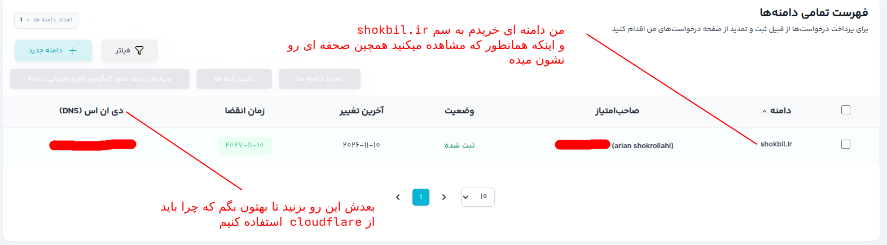
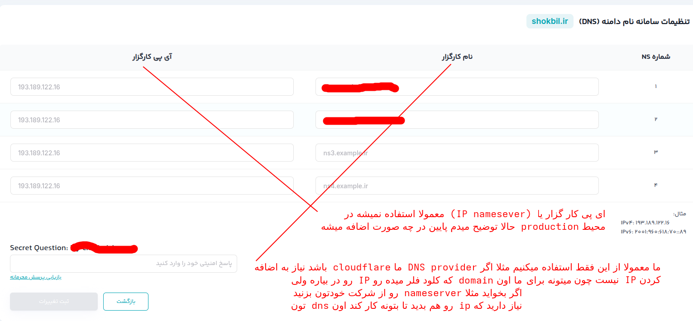
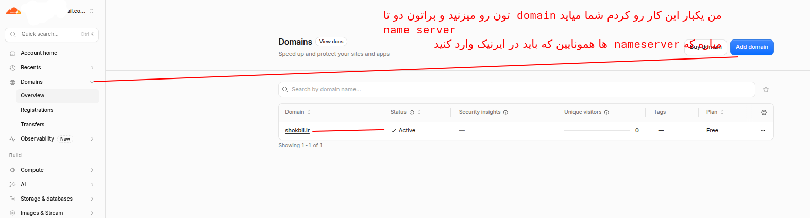
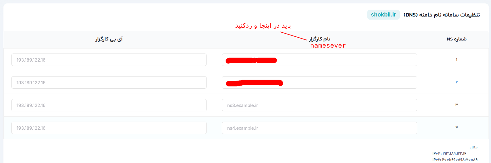

##  0 تا 100 خرید DNS و فعال کردن اون
---
## مراحل خرید DNS از ایرنیک و دادن NAMESERVER بهش

ا-<mark>اول</mark>----> انتخاب میکنید که  پسوند و اون سایت چی باشه من خودم ir. رو انتخاب کردم و شما هم باید انتخاب کنید بر اساس اون بودجتون و علاقتون که چی بزارید اون Suffix یا پسوند دامنتون رو 

---

ا-<mark>دوم</mark> شما ---> میرید داخله سایت ایرنیک ---> به ادرس nic.ir 
بعد اگر ثبت نام کردید وارد حسابتون شید و اگر ثبت نام نکردید یه خورده طولانیه 

ثبت نام در ایرنیک(nic.ir)---> میرید ثبت نام میکنید و دامنه مورد نظرتون رو انتخاب میکنید و در هنگام پرداخت و انتخاب اون دامنه باید برید درون سایت <mark> هدا (هویت دیجیتال ایرانیان)</mark> احرازهویت (authentication)کنید. سامانه ها اصلن چیست و چرا:
#### سامانه هُدا چیست؟

هُدا مخفف هویت دیجیتال ایرانیان است و برای احراز هویت دیجیتال افراد استفاده می‌شود.

ایرنیک برای اطمینان از اینکه شخصی که دامنه `.ir` ثبت می‌کند واقعاً همان مالک معرفی‌شده است، از این فرایند احراز هویت استفاده می‌کند.

این فرایند برای کاربران حقیقی شامل تأیید اطلاعات هویتی و احراز هویت تصویری است.

---

ا-<mark>سوم</mark> ---> بعد از اینکه شما احرازهویت کردید میرید و اون دامنه رو میخرید
و بعد برایه شما چیزی مثل این نشون میده

<p align=center>
	
</p>

---

ا-<mark>چهارم</mark> ---> وقتی بزنید رویه اون  DNS یه همچین صحفه ای میبینید

<p align=center>
	
</p>

### فهمیدید چی شد دو مدل دارد پس تنظیمات dns درون ایرنیک:

ا-<mark> ۱. حالت اول</mark>: Nameserver متعلق به شرکت دیگری است

فرض کن DNS دامنه‌ات را به Cloudflare سپرده‌ای:

```
aron.ns.cloudflare.com
garrett.ns.cloudflare.com
```

در NIC فقط نام کارگزار را وارد می‌کنی و IP را خالی می‌گذاری. همین کاری که من کردم

ا-<mark> ۲. حالت دوم</mark>: Nameserver متعلق به خودت است

فرض کن شرکتت دامنه زیر را دارد:

```
company.com
```

و می‌خواهی DNS Server اختصاصی خودت را معرفی کنی:

```
ns1.company.com
```

حالا یک مشکل داریم:

برای پیدا کردن IP دامنه `ns1.company.com` باید DNS را جست‌وجو کنیم، اما DNS همین دامنه قرار است روی `ns1.company.com` باشد!

اینجا به Glue Record نیاز داریم.

مثلاً:

|فیلد|مقدار|
|---|---|
|Nameserver|ns1.company.com|
|IP|203.0.113.10|

ا-<mark> ما از حالت ۱ استفاده کردیم چون:</mark> چون  nameserver IP ما رو DNS resolver میتونه پیدا کند چون ماله cloudflare

 مقایسه در Production

|سناریو|نام کارگزار|IP کارگزار|
|---|---|---|
|Cloudflare|لازم|معمولاً خالی|
|AWS Route 53|لازم|معمولاً خالی|
|DNS Provider خارجی|لازم|معمولاً خالی|
|Nameserver اختصاصی داخل دامنه خودت|لازم|Glue IP لازم|

 نتیجه‌ای که باید یاد بگیری

دو مفهوم را از هم جدا کن:

- ا-NS Record: مشخص می‌کند مسئول مدیریت DNS دامنه کدام Nameserver است.
    
- ا-Glue Record: آدرس IP کمکی Nameserver را در Zone والد قرار می‌دهد تا مشکل وابستگی دوری حل شود.

---

ا-<mark>پنجم</mark> ---> حالا اون name server haro از کجا بیاریم شما میرید درون کلود فلر یا (DNS provider)


<p align=center>
	
</p>

---

ا-<Mark>ششم</mark>---> حال بعد اینکه دامنتون رو اد کردید و قبول شد برایه شما دو تا name srever میاره که این ها همونایی هستند که باید در بخش


<p align=center>
	
</p>

---

ا-<mark>هفتم</mark>---> حالا باید فرصت بدید تا فرایند DNS Delegation و برسی شود که اون nameserver هایی که وارد کردید از کجاست بین ۱ تا ۲۴ ساعت زمان میبره و بعد 

ا-Delegation چیست؟

ما این دو Nameserver را در پنل NIC ثبت کردیم.

در واقع به NIC گفتیم:

«مدیریت DNS دامنه من را به این دو Nameserver واگذار کن.»

ا-NIC هم اطلاعات این واگذاری را در Zone والد `.ir` منتشر کرد.

به این فرایند Delegation می‌گوییم.

---
ا-<mark>هشتم</mark> ---->برای تست DNS Delegation با دستور `dig` چند روش داریم. می‌خواهیم مطمئن شویم NIC دامنه را به Nameserverهای Cloudflare واگذار کرده است.

دامنه ما:

```
shokbil.ir
```

Nameserver مثلا های ما:

```
aron.ns.cloud.com
garrett.cloudflare.com
```

### تست Delegation از خود NIC.ir

این مهم‌ترین تست ماست:

```
dig @a.nic.ir shokbil.ir NS +norecurse
```

|بخش|معنی|کاربرد|
|---|---|---|
|`dig`|DNS Lookup|ابزار بررسی DNS|
|`@a.nic.ir`|DNS Server مقصد|ارسال مستقیم درخواست به NIC|
|`shokbil.ir`|Domain|دامنه مورد بررسی|
|`NS`|Query Type|درخواست رکوردهای Nameserver|
|`+norecurse`|غیرفعال‌کردن Recursion|درخواست پاسخ مستقیم از سرور مقصد|

خلاصه: از Nameserver رسمی NIC می‌پرسیم که Nameserverهای مسئول دامنه `shokbil.ir` کدام‌اند؛ بدون درخواست جست‌وجوی بازگشتی.

خروجی مورد انتظار:

```
status: NOERROR

AUTHORITY SECTION:
shokbil.ir. 900 IN NS garrett.ns.cloud.com.
shokbil.ir. 900 IN NS aron.cloudflare.com.
```

این خروجی چه معنایی دارد؟

- ا-`NOERROR`: درخواست با موفقیت پاسخ داده شده است.
    
- ا-`NS`: نوع رکوردی که درخواست کرده‌ایم.
    
- ا-`AUTHORITY SECTION`: در این پاسخ، اطلاعات Delegation در بخش Authority قرار گرفته است.
    
- ا-`+norecurse`: از NIC می‌خواهیم خودش به درخواست پاسخ دهد و جست‌وجوی بازگشتی انجام ندهد.
    

نکته مهم: در این تست ممکن است `ANSWER: 0` ببینی؛ این طبیعی است، چون NIC به‌عنوان Zone والد، اطلاعات Nameserverهای دامنه فرزند را در بخش Authority معرفی می‌کند.

### تست Delegation از DNS عمومی Cloudflare

```
dig @1.1.1.1 NS shokbil.ir +short
```

|بخش|معنی|کاربرد|
|---|---|---|
|`dig`|DNS Lookup|ابزار بررسی DNS|
|`@1.1.1.1`|Cloudflare DNS Resolver|ارسال درخواست به DNS عمومی Cloudflare|
|`NS`|Query Type|درخواست رکوردهای Nameserver|
|`shokbil.ir`|Domain|دامنه مورد بررسی|
|`+short`|Short Output|نمایش خلاصه پاسخ، بدون جزئیات اضافی|

خلاصه: از DNS عمومی Cloudflare می‌پرسیم Nameserverهای دامنه `shokbil.ir` کدام‌اند و فقط پاسخ نهایی را نمایش می‌دهیم.

خروجی مورد انتظار:

```
aron.ns.cloud.com.
garrett.cloudflare.com.
```

این تست نشان می‌دهد DNS Resolver عمومی هم Nameserverهای دامنه را پیدا می‌کند.

---
ا-<mark>نهم</mark>:---> تست مستقیم DNS Serverهای Cloudflare

تا اینجا فهمیدیم NIC دامنه را به Cloudflare واگذار کرده است. حالا باید مطمئن شویم خود Cloudflare هم Zone دامنه ما را نگهداری می‌کند.

ابتدا Nameserver اول را تست کن:

```
dig @aron.cloudflare.com shokbil.ir SOA +norecurse
```

سپس Nameserver دوم:

```
dig @garrett.ns.cloud.com shokbil.ir SOA +norecurse
```
خروجی مورد انتظار:

```
status: NOERROR
flags: qr aa
```

مهم‌ترین قسمت <mark>`aa`</mark> است:

`AA = Authoritative Answer`

یعنی Cloudflare خودش پاسخ معتبر مربوط به Zone دامنه را ارائه می‌دهد.

این تست را برای هر دو Nameserver انجام می‌دهیم تا مطمئن شویم هر دو درست کار می‌کنند.

---
ا-<mark> دهم </mark> ----> برایه این بخش اول فایل  [01-section-10-requirements.md](section 10 requirements )رو بخونید 
